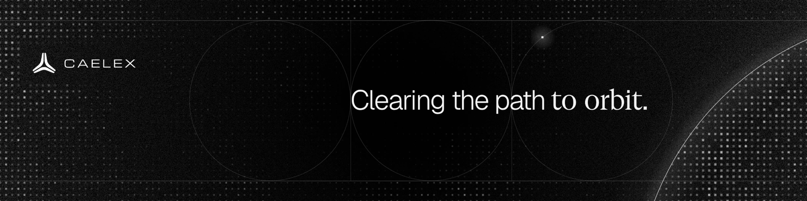

 

CAELEX OCULAR

### Export-control classification, with its reasoning attached.

Ocular reads a part's datasheet and returns its control-list position, the legal derivation and a signed record. For every manufacturer that exports, starting with space and defence.

[caelex.eu](https://www.caelex.eu) &nbsp;·&nbsp; [Try Ocular](https://www.caelex.eu/ocular) &nbsp;·&nbsp; [Book a walkthrough](https://www.caelex.eu/contact) &nbsp;·&nbsp; [LinkedIn](https://linkedin.com/company/caelex)

 

THE PROBLEM

### Every part a supplier ships has to be classified first.

The EU dual-use list alone runs to thousands of positions, with UK, US and military lists on top, and new editions every year. Today the code lives in the ERP while the reasoning lives in an email or in someone's head, and the next list edition starts the work over.

 

HOW OCULAR WORKS

### Datasheet in. List position and proof out.

<table>
  <tr>
    <td width="25%" valign="top">01 <b>Read</b> Values come from the datasheet with page and position. Gaps stay open. Nothing is guessed.</td>
    <td width="25%" valign="top">02 <b>Ask</b> A few guided questions settle what the datasheet leaves open.</td>
    <td width="25%" valign="top">03 <b>Decide</b> A deterministic engine checks the official list edition and shows why. <code>UNKNOWN</code> is a valid outcome.</td>
    <td width="25%" valign="top">04 <b>Sign</b> The officer confirms. A hash-chained record is kept, and the code goes back to the ERP.</td>
  </tr>
</table>

 

OUR INSIGHT

### In export control, a guess is worthless.

<table>
  <tr>
    <td width="33%" valign="top"><b>Zero tolerance</b> A wrong classification is a violation. Being right most of the time is not a product.</td>
    <td width="33%" valign="top"><b>The data is controlled</b> Datasheets can themselves be controlled technology. They cannot go to a model abroad.</td>
    <td width="33%" valign="top"><b>So we compile the law</b> Official list text becomes tested rules. A deterministic engine decides, an officer signs. In the cloud or on-premise.</td>
  </tr>
</table>

 

COVERAGE

### Built on the official lists.

EU Dual-Use Regulation 2021/821 &nbsp;·&nbsp; EU Common Military List &nbsp;·&nbsp; German Ausfuhrliste &nbsp;·&nbsp; UK strategic export lists &nbsp;·&nbsp; ITAR &nbsp;·&nbsp; EAR &nbsp;·&nbsp; MTCR

 

TEAM

### Three founders.

<table>
  <tr>
    <td width="33%" valign="top"><b><a href="https://github.com/Polleschnerjulian-creator">Julian Polleschner</a></b> <code>Co-Founder &amp; CEO</code> Leads product and the regulatory spine. <a href="https://www.linkedin.com/in/julian-polleschner-a90943281/">LinkedIn</a></td>
    <td width="33%" valign="top"><b>Niklas Wieczorek</b> <code>Co-Founder &amp; COO</code> Runs operations and delivery. <a href="https://www.linkedin.com/in/wieczorek-niklas/">LinkedIn</a></td>
    <td width="33%" valign="top"><b>Pantaleon Quick</b> <code>Co-Founder &amp; Chief Scientist</code> Leads proof engines, agent architecture and cryptographic attestation. <a href="https://www.linkedin.com/in/pantaleon-quick-266bb4292/">LinkedIn</a></td>
  </tr>
</table>

 

### Clearing the path for everything Europe exports.

Investors, integrators and heads of export control: we'd like to show you Ocular on your own parts.
**[Book a walkthrough](https://www.caelex.eu/contact)**

 

Caelex is software. It is not legal advice and does not grant export licences. The officer confirms every classification.
